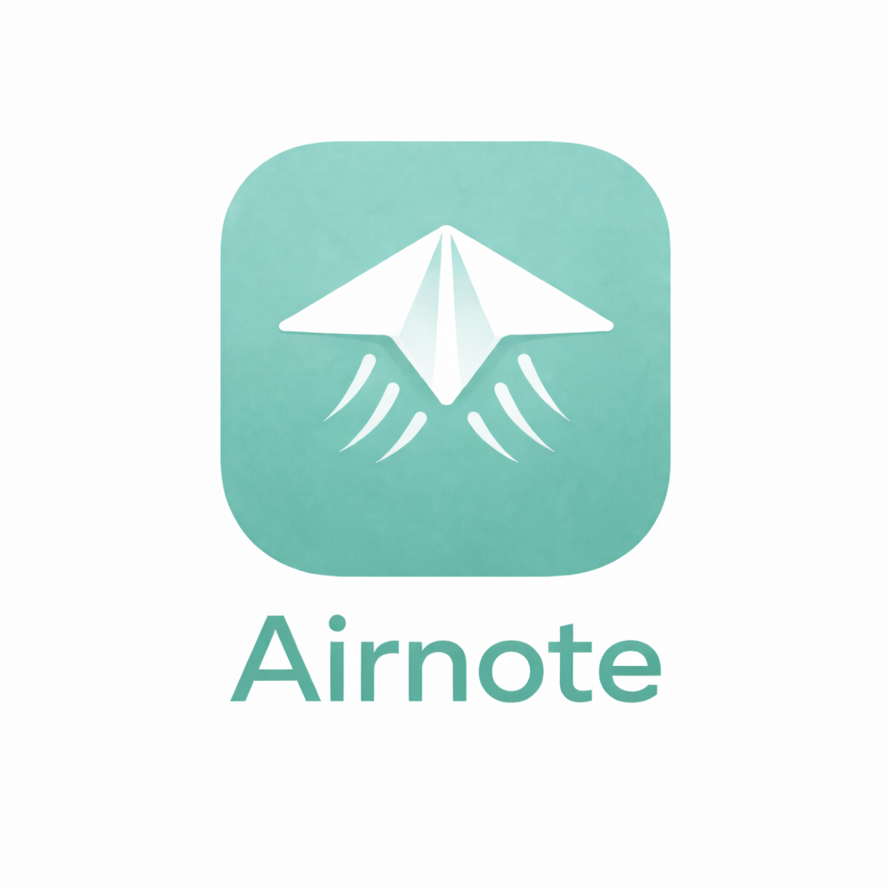

<div align="center">
  

  # Airnote

  **A location-based ephemeral notes app built with React Native and Expo**

  
  
  
</div>

---

## 💡 The Problem & Solution

### The Problem
Modern social media is permanent, global, and overwhelming. Every post lives forever, reaches everyone, and contributes to information overload. Local communities lack a lightweight way to share timely, location-specific information without the baggage of traditional social platforms.

**Real-world scenarios that are poorly served:**
- 🚧 Warning neighbors about a road closure or construction noise
- 🎉 Inviting people in your building to an impromptu gathering
- 🔑 Reporting a lost item at a specific location
- ℹ️ Sharing tips about a local spot (best time to visit, secret menu items)
- 🚨 Alerting people nearby about immediate safety concerns

Traditional solutions fall short:
- **Group chats**: Require pre-existing relationships and clutter over time
- **Nextdoor/Facebook**: Too permanent, too broad, and full of noise
- **Twitter/Instagram**: Global reach when you need hyper-local context
- **Physical notes**: Limited visibility and require physical presence to post

### The Solution: Ephemeral, Location-Bound Communication

Airnote reimagines how we share information in physical spaces by making notes:

**🗺️ Location-Bound**
- Notes are tied to specific coordinates and only appear when you're nearby
- You control the radius: share with just your building (30ft) or entire neighborhood (1 mile)
- Creates context-aware feeds that change as you move through the world

**⏱️ Ephemeral by Design**
- Notes automatically expire (15 minutes to 24 hours)
- No permanent record, no profile history, no digital footprint
- Encourages timely, relevant content over endless scrolling

**🎯 Friction-Free**
- No friending, following, or profile building required
- Open a note, write, set duration and radius, post
- Discover what's relevant right now, right here

**🌊 Ambient & Calm**
- Feed updates automatically as distances change
- Visual map shows clusters of activity around you
- Private notes feature for personal location-based reminders

### Why It Matters

Airnote bridges the gap between digital communication and physical space. It's designed for the **here and now**, not the permanent record. By combining location awareness with ephemerality, it creates a new category of social tool: one that enhances your physical environment rather than replacing it.

Perfect for:
- College campuses and student housing
- Apartment buildings and neighborhoods
- Event venues and conferences
- Parks, trails, and outdoor spaces
- Coffee shops and local businesses

### How Airnote is Different

| Feature | Airnote | Nextdoor | Yik Yak | Twitter/X | Snapchat Map |
|---------|---------|----------|---------|-----------|--------------|
| **Content Lifetime** | Auto-expires (15m-24h) | Permanent | Permanent | Permanent | Stories: 24h |
| **Discovery Radius** | User-defined (30ft-1mi) | Entire neighborhood | ~5 miles | Global | Friend-dependent |
| **Profile Required** | No | Yes (verified address) | No | Yes | Yes (friends only) |
| **Use Case** | Hyper-local, timely info | Community discussions | Campus gossip | Global conversation | Sharing with friends |
| **Privacy Model** | Anonymous by default | Real identity required | Anonymous | Public identity | Friends only |
| **Noise Level** | Low (only nearby, recent) | High (all neighborhood) | Medium | Very high | Low (curated friends) |
| **Map View** | Shows all public notes | No map view | No map view | No native map | Shows friends only |
| **Offline Utility** | Private location notes | None | None | None | None |

**Key Differentiators:**

1. **Precision Location Control**
   - Unlike Nextdoor (neighborhood-wide) or Yik Yak (fixed radius), you choose exactly how far your note reaches
   - Post to just your building vs. entire block vs. whole area

2. **True Ephemerality**
   - Not just "disappearing messages" - the entire concept is time-bound
   - Encourages current, actionable content over endless archives
   - No "permanent record" anxiety

3. **No Social Graph Required**
   - Zero setup: open app, see nearby notes, post your own
   - No friending, no followers, no profiles
   - Content discovered by proximity, not social connections

4. **Ambient Awareness**
   - Feed changes as you physically move through space
   - Distance indicators update in real-time
   - Creates a living layer of information over the physical world

5. **Private Notes Feature**
   - Leave yourself location-based reminders
   - Remember places to revisit or details about locations
   - Never posted publicly - totally personal

6. **Designed for Immediacy**
   - Short-form content (like Twitter)
   - But only relevant to people nearby, right now
   - No viral mechanics or engagement farming

**What Airnote is NOT:**
- ❌ Not a permanent social network
- ❌ Not a review platform (use Yelp/Google)
- ❌ Not a messaging app (use iMessage/WhatsApp)
- ❌ Not a friend-finder (use dating apps/Meetup)
- ❌ Not a news aggregator (use Reddit/Twitter)

**What Airnote IS:**
- ✅ A lightweight, timely communication layer for physical spaces
- ✅ A tool for sharing what's happening **right here, right now**
- ✅ A way to enhance physical environments with ephemeral digital context

---

## ⚠️ Current Status: MVP Prototype

This is a **fully functional prototype** with in-memory data storage. All data is lost when the app restarts. This app is **not production-ready** and requires backend infrastructure to be deployed.

**What works:**
- ✅ Location-based note discovery and creation
- ✅ Ephemeral notes with expiration timers
- ✅ Map visualization with clustering
- ✅ Private notes feature
- ✅ Comments system
- ✅ Dark mode and text size controls
- ✅ Real-time distance filtering

**What's missing for production:**
- ❌ Backend database (no data persistence)
- ❌ User authentication (single mock user)
- ❌ Real-time sync across devices
- ❌ Content moderation system
- ❌ Push notifications
- ❌ Analytics and crash reporting

See the [Production Roadmap](#-production-roadmap) section for details.

- **Location-based notes**: Create and discover notes near your current location
- **Ephemeral content**: Notes expire after a set duration (15m, 30m, 1h, 4h, 24h)
- **Proximity filtering**: Notes only appear within their defined radius (10m, 25m, 50m, 100m)
- **Clean iOS-inspired UI**: Minimal, airy design with custom color palette
- **Real-time updates**: Feed automatically updates to show current distances and time remaining

## 🚀 Quick Start - Running the App

### Prerequisites

Before you begin, make sure you have:

1. **Node.js** (v18 or later recommended)
   - Download from [nodejs.org](https://nodejs.org/)
   - Verify installation: `node --version`

2. **npm** or **yarn** (comes with Node.js)
   - Verify: `npm --version`

3. **Expo Go App** (for testing on physical device)
   - Download from [App Store (iOS)](https://apps.apple.com/app/expo-go/id982107779)
   - Download from [Google Play (Android)](https://play.google.com/store/apps/details?id=host.exp.exponent)

4. **iOS Simulator** (Mac only - optional)
   - Install Xcode from Mac App Store
   - Open Xcode → Settings → Components → Install iOS Simulator

5. **Android Emulator** (optional)
   - Install [Android Studio](https://developer.android.com/studio)
   - Set up an Android Virtual Device (AVD)

### Installation & Running

#### Step 1: Clone and Install Dependencies

```bash
# Navigate to the project directory
cd /path/to/Airnote-Build

# Install all dependencies
npm install
```

#### Step 2: Start the Expo Development Server

```bash
# Start the development server
npm start

# Or use these alternative commands:
npx expo start              # Same as npm start
npx expo start --clear      # Start with cache cleared (if you have issues)
```

This will:
- Start the Metro bundler
- Open Expo DevTools in your browser
- Display a QR code in your terminal

#### Step 3: Run the App

You have **three options** to run the app:

**Option 1: Physical Device (Recommended for testing location features)**

1. Install **Expo Go** app on your phone (see Prerequisites)
2. Make sure your phone and computer are on the **same Wi-Fi network**
3. Scan the QR code from the terminal:
   - **iOS**: Use the Camera app to scan the QR code
   - **Android**: Use the Expo Go app to scan the QR code
4. The app will load on your device

**Option 2: iOS Simulator (Mac only)**

```bash
# In the Expo DevTools terminal, press 'i'
# Or run:
npx expo start --ios
```

**Option 3: Android Emulator**

```bash
# Make sure Android emulator is running first
# In the Expo DevTools terminal, press 'a'
# Or run:
npx expo start --android
```

#### Step 4: Enable Location Permissions

When the app launches for the first time:

- **iOS**: A popup will ask for location permission → Tap **"Allow While Using App"**
- **Android**: A popup will request location access → Tap **"Allow"**

⚠️ **Important**: The app requires location access to function. Without it, you won't see any notes or be able to create them.

### Development Tips

**Hot Reload**
- Changes to code automatically reload the app
- Press `r` in terminal to manually reload
- Shake your device to open the developer menu

**Useful Commands**
```bash
npm start                    # Start development server
npx expo start --clear       # Clear cache and start
npx expo start --offline     # Start without checking for updates
npx expo start --lan         # Use LAN instead of localhost
```

**Developer Menu**
- **iOS Simulator**: Press `Cmd + D`
- **Android Emulator**: Press `Cmd + M` (Mac) or `Ctrl + M` (Windows/Linux)
- **Physical Device**: Shake the device

**View Logs**
```bash
# Terminal will show logs automatically
# Or press 'd' in terminal to open developer tools
```

### Troubleshooting

**Issue: "Unable to resolve module"**
```bash
# Clear cache and reinstall
rm -rf node_modules
npm install
npx expo start --clear
```

**Issue: "Network response timed out"**
- Ensure phone and computer are on same Wi-Fi
- Try running: `npx expo start --lan`
- Disable VPN if active

**Issue: "Location permission denied"**
- iOS: Settings → Privacy & Security → Location Services → Expo Go → "While Using"
- Android: Settings → Apps → Expo Go → Permissions → Location → "Allow only while using the app"

**Issue: Expo Go app shows blank screen**
- Shake device → Reload
- Close and restart Expo Go app
- Check terminal for error messages

**Issue: "Command not found: expo"**
```bash
# Install Expo CLI globally (optional)
npm install -g expo-cli

# Or always use npx:
npx expo start
```

### Testing the App

Once running, you can:

1. **View the Home feed** - See mock notes created by the app (seeded data)
2. **Create a note** - Tap the + button, write content, set duration/radius
3. **View Map** - Tap Map tab to see notes visualized on a map
4. **Try Private Notes** - Tap My Notes tab to create location-based personal reminders
5. **Test Dark Mode** - Tap Settings → Toggle Dark Mode
6. **Adjust Text Size** - Tap Settings → Select text size preference

**Note**: Since this is a prototype with in-memory storage, all notes reset when you restart the app.

### Location Permissions & Privacy

The app requires location permissions to function:
- **iOS**: Permission requested on first launch - choose "Allow While Using App"
- **Android**: Location permissions declared in [app.json](app.json)
- **Privacy**: Location data is only used locally in this prototype. No data is sent to any server.

## Project Structure

```
airnote/
├── src/
│   ├── components/        # React components
│   │   ├── Header.tsx
│   │   ├── LocationChip.tsx
│   │   ├── NoteCard.tsx
│   │   ├── FloatingActionButton.tsx
│   │   └── CreateNoteModal.tsx
│   ├── hooks/             # Custom React hooks
│   │   └── useLocation.ts
│   ├── services/          # Business logic
│   │   └── notesService.ts
│   ├── theme/             # Design tokens
│   │   └── colors.ts
│   ├── types/             # TypeScript types
│   │   └── note.ts
│   └── utils/             # Helper functions
│       └── location.ts
├── App.tsx                # Main app component
├── app.json              # Expo configuration
└── package.json
```

## Architecture

### Current Data Layer: In-Memory Mock

⚠️ **All data is lost when the app restarts** - This is prototype-only architecture.

The app uses in-memory arrays in service files:
- `notesService.ts` - Public notes (ephemeral)
- `privateNotesService.ts` - Private notes
- `commentsService.ts` - Comments on notes

```typescript
// Current: In-memory storage (prototype only)
let notes: Note[] = []
notesService.createNote(...) // Adds to array
notesService.getNearbyNotes(...) // Filters array by location

// Production: Supabase database
await supabase.from('notes').insert({...})
await supabase.from('notes').select('*')
  .filter('location', 'within', userLocation, radius)
```

**Why this pattern?**
- Service abstraction makes backend swap easy
- Same method signatures, different implementations
- No business logic changes needed in UI components

### Production Data Layer (Recommended)

```
┌─────────────────────────────────────────────┐
│  React Native App (iOS/Android)             │
├─────────────────────────────────────────────┤
│  Service Layer (notesService.ts, etc.)      │
│  - Supabase Client                          │
│  - Real-time subscriptions                  │
│  - Auth management                          │
├─────────────────────────────────────────────┤
│  Supabase Backend                           │
│  ├─ PostgreSQL + PostGIS (spatial queries)  │
│  ├─ Auth (JWT sessions)                     │
│  ├─ Real-time (WebSocket subscriptions)     │
│  ├─ Storage (future: photo uploads)         │
│  └─ Edge Functions (moderation, cleanup)    │
└─────────────────────────────────────────────┘
```

### Key Components

- **Header**: App title and notification bell icon placeholder
- **LocationChip**: Shows current location with reverse geocoding
- **NoteCard**: Displays individual notes with distance and time remaining
- **FloatingActionButton**: Primary action for creating new notes
- **CreateNoteModal**: Bottom sheet for composing notes

### Location Service

- Uses `expo-location` for accessing device location
- Requests permissions on launch
- Reverse geocodes coordinates to show neighborhood/city name
- Calculates distances using Haversine formula

### Note Filtering

Notes are filtered by:
1. **Distance**: User must be within the note's defined radius
2. **Expiration**: Notes past their expiration time are automatically purged

## Color Palette

```
#FBFAFB - Background
#C9E7E4 - Primary Light (location chip)
#86CAC3 - Primary
#77BEB7 - Primary Medium
#74B7B1 - Primary Dark (buttons, accents)
```

## 🚀 Production Roadmap

To make Airnote production-ready, the following infrastructure is required:

### 1. Backend & Database Integration (Critical)

**Recommended: Supabase**

The app currently uses in-memory storage that resets on restart. Replace with Supabase for:

- **PostgreSQL database** with tables:
  ```sql
  - users (id, email, created_at, preferences)
  - notes (id, user_id, content, location, radius, expires_at, category)
  - comments (id, note_id, user_id, content, created_at)
  - private_notes (id, user_id, content, location, expires_at)
  ```

- **Spatial queries** using PostGIS extension:
  - Find notes within radius: `ST_DWithin(location, user_location, radius)`
  - Efficient distance calculations

- **Real-time subscriptions** for live updates:
  ```javascript
  supabase
    .channel('notes')
    .on('postgres_changes', { event: 'INSERT', schema: 'public', table: 'notes' },
      payload => updateFeed(payload.new))
    .subscribe()
  ```

- **Row Level Security (RLS)** for privacy:
  - Users can only delete their own notes
  - Private notes only visible to creator
  - Location-based access control

**Implementation steps:**
1. Create Supabase project
2. Set up database schema with spatial extensions
3. Replace `notesService.ts` to use Supabase client
4. Add real-time subscriptions for feed updates
5. Implement RLS policies
6. Add database migrations

### 2. Authentication System (Critical)

**Use Supabase Auth** to replace mock user system:

- Email/password authentication
- Social logins (Google, Apple)
- Session management with JWT tokens
- Password reset flow
- Email verification

**Implementation steps:**
1. Add login/signup screens
2. Replace hard-coded `CURRENT_USER_ID` with `supabase.auth.getUser()`
3. Add auth guards to navigation
4. Store user preferences in `users` table
5. Implement sign out functionality

**Code changes needed:**
```typescript
// Current (mock):
const CURRENT_USER_ID = 'current-user'

// Production (Supabase):
const { data: { user } } = await supabase.auth.getUser()
const userId = user?.id
```

### 3. Content Moderation & Safety (Critical)

**Required for public launch:**

- **Report mechanism**: Add "Report" button to notes
- **Rate limiting**: Limit note creation (e.g., 1 note per minute)
- **Content filtering**: Block profanity and spam
- **Moderation dashboard**: Admin panel to review reports
- **User blocking**: Allow users to hide content from specific users
- **Spam prevention**: Captcha or verification for new accounts

**Implementation options:**
- Use OpenAI Moderation API for content filtering
- Implement Supabase Edge Functions for rate limiting
- Build admin dashboard with Supabase + React Admin

### 4. Data Privacy & Security (Critical)

- **HTTPS everywhere**: Enforce TLS for all API calls
- **Data encryption**: Encrypt private notes at rest
- **Privacy policy**: Add legal documents
- **GDPR compliance**:
  - Data export functionality
  - Account deletion with data purge
  - Cookie consent (if using web)
- **Location privacy**: Option to fuzz exact location

### 5. Push Notifications (Important)

**Use Expo Notifications + Supabase Edge Functions:**

- Notify when someone comments on your note
- Alert when near a place with your private notes
- Weekly digest of nearby activity

**Setup:**
1. Configure Expo push notification credentials
2. Store device tokens in `users` table
3. Create Supabase Edge Functions to send notifications
4. Handle notification permissions gracefully

### 6. Analytics & Monitoring (Important)

**Crash Reporting:**
- Add **Sentry** for error tracking
- Log API failures and location permission issues

**Usage Analytics:**
- Add **PostHog** or **Mixpanel** for product analytics
- Track: note creation rate, feed engagement, map usage
- Monitor retention and churn

**Performance:**
- Use Expo performance monitoring
- Track app launch time and frame rate

### 7. Testing & Quality Assurance (Important)

**Currently: No tests**

Add testing infrastructure:
- **Jest** + **React Native Testing Library** for unit tests
- **Detox** for E2E testing
- Mock services for isolated component tests
- CI/CD pipeline with GitHub Actions
- Automated testing on PR

**Test coverage targets:**
- Services: 80%+
- Components: 70%+
- Screens: 60%+

### 8. Deployment Infrastructure (Required)

**Current state: Local development only**

Production deployment needs:
- **EAS Build** for app binaries
- **TestFlight** (iOS) and **Google Play Console** (Android) setup
- **Staging environment** for testing
- **Environment variables** management (.env files)
- **App store assets**: Screenshots, descriptions, privacy policy
- **Version management**: Semantic versioning

### 9. Onboarding Flow (Recommended)

Per `TO-DO.md`, implement:
- 3-slide intro explaining the concept
- Smart location permission request
- Graceful "Location Off" fallback mode
- First note creation tutorial

### 10. Feature Enhancements (Nice-to-Have)

- Photo attachments (use Supabase Storage)
- User profiles with reputation scores
- Advanced filtering (by category, time range)
- Geofencing for push notifications
- Offline mode with sync
- Multi-language support

---

## 🛠️ Quick Start Guide

### Production Implementation Timeline

| Phase | Tasks | Estimated Time |
|-------|-------|----------------|
| **Phase 1** | Supabase setup, database schema, basic CRUD | 1-2 weeks |
| **Phase 2** | Authentication, user management | 1-2 weeks |
| **Phase 3** | Real-time sync, push notifications | 1-2 weeks |
| **Phase 4** | Content moderation, safety features | 1-2 weeks |
| **Phase 5** | Testing, QA, bug fixes | 2-3 weeks |
| **Phase 6** | App store setup, deployment | 1 week |
| **Total** | **MVP to Production** | **8-13 weeks** |

---

## 🎯 Why This Architecture?

**Frontend (Current):** React Native + Expo
- ✅ Cross-platform (iOS + Android)
- ✅ Fast development with hot reload
- ✅ Rich ecosystem of libraries
- ✅ Easy OTA updates with Expo

**Backend (Recommended):** Supabase
- ✅ PostgreSQL with spatial queries (PostGIS)
- ✅ Built-in authentication
- ✅ Real-time subscriptions
- ✅ Row-level security
- ✅ Free tier for MVP
- ✅ Auto-generated REST API
- ✅ File storage for future photo uploads
- ✅ Edge Functions for serverless logic

**Alternatives considered:**
- Firebase: Good, but less powerful for spatial queries
- Custom backend: More flexible, but 3x development time
- AWS Amplify: Complex setup, overkill for MVP

---

## Tech Stack

### Current (Prototype)
- **React Native 0.81**: UI framework
- **Expo SDK 54**: Development platform
- **TypeScript 5.3**: Type safety
- **expo-location**: GPS and reverse geocoding
- **react-native-maps**: Map visualization
- **React Navigation**: Tab and stack navigation
- **Nominatim API**: Place search (OpenStreetMap)
- **Overpass API**: Nearby POI discovery

### Production (Recommended Additions)
- **Supabase**: Backend, database, auth, real-time sync
- **Sentry**: Error tracking and crash reporting
- **PostHog** or **Mixpanel**: Product analytics
- **Expo Notifications**: Push notifications
- **Jest + React Native Testing Library**: Testing
- **EAS Build**: App deployment pipeline

---

## 🚧 Development Status & Next Steps

### What This Repo Contains

This is a **functional prototype** demonstrating the core UX and features of Airnote. The app works perfectly for local testing and development, but lacks the infrastructure for production deployment.

### Immediate Next Steps to Launch

1. **Week 1-2: Supabase Setup**
   - [ ] Create Supabase project
   - [ ] Design database schema with PostGIS
   - [ ] Replace in-memory services with Supabase client
   - [ ] Test spatial queries

2. **Week 3-4: Authentication**
   - [ ] Build login/signup screens
   - [ ] Integrate Supabase Auth
   - [ ] Add auth guards to navigation
   - [ ] Implement sign out flow

3. **Week 5-6: Real-time & Sync**
   - [ ] Add Supabase real-time subscriptions
   - [ ] Implement feed auto-sync
   - [ ] Add push notification setup
   - [ ] Handle offline scenarios

4. **Week 7-8: Safety & Moderation**
   - [ ] Add content moderation
   - [ ] Implement rate limiting
   - [ ] Build report mechanism
   - [ ] Add user blocking

5. **Week 9-10: Testing & Polish**
   - [ ] Write unit tests (70%+ coverage)
   - [ ] End-to-end testing with Detox
   - [ ] Fix bugs and edge cases
   - [ ] Performance optimization

6. **Week 11-13: Deployment**
   - [ ] App store assets and screenshots
   - [ ] Privacy policy and terms
   - [ ] TestFlight and Google Play beta
   - [ ] Production launch

### Getting Help

For production implementation support:
- **Supabase Docs**: https://supabase.com/docs
- **Expo Docs**: https://docs.expo.dev
- **React Native**: https://reactnative.dev

---

## 📄 License

MIT

---

<div align="center">
  <p><strong>Built with ❤️ using React Native, Expo, and TypeScript</strong></p>
  <p><em>Ready to be powered by Supabase for production deployment</em></p>
</div>
